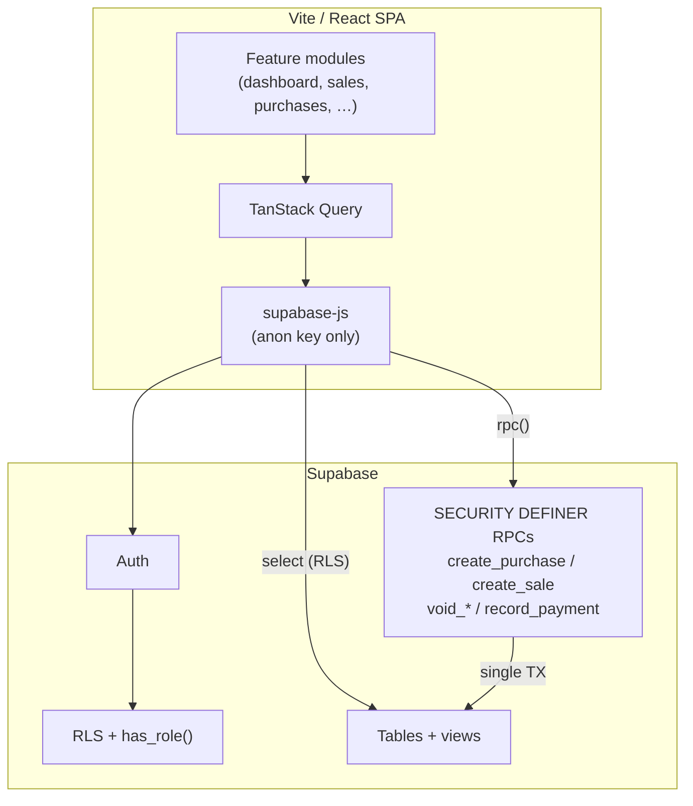
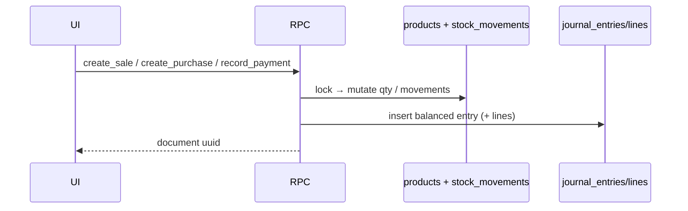

# Mini ERP

Small multi-role ERP for **Sales**, **Purchase**, **Inventory**, and **Accounts**. The browser talks to **Supabase** (Auth + Postgres + RLS). Posted documents never delete stock or ledgers from the client — every business event runs through a **Postgres RPC in one transaction**.

**Stack:** Vite · React 18 · TypeScript strict · Tailwind · shadcn/ui · TanStack Query · react-router · react-hook-form + zod · Supabase · Recharts

---

## Architecture



**Layout**

```
src/app              # router, providers, shell
src/features/<mod>   # auth, products, parties, purchases, sales,
                     # inventory, accounts, dashboard  (no cross-feature internals)
src/shared           # query keys, money helpers, pagination
src/lib              # supabase client
supabase/migrations  # 0001–0010 schema, RPCs, RLS, seed, reports
supabase/tests       # SQL regression scripts
```

---

## Schema summary

| Area | Tables / views | Notes |
|------|----------------|-------|
| Identity | `profiles` | 1:1 `auth.users`; role enum `admin \| sales \| purchase \| accountant` |
| Masters | `products`, `parties` | Soft-deactivate (`is_active`); money `numeric(14,2)`, qty `numeric(14,3)` |
| Ops | `purchases` / `purchase_items`, `sales` / `sale_items` | Status `posted \| void`; `amount_paid`, `discount` on headers |
| Stock | `stock_movements` | Append-only; signed `qty_delta`; client DML revoked |
| GL | `accounts`, `journal_entries`, `journal_lines` | Deferred balance trigger; XOR debit/credit per line |
| Cash | `payments` | Receipt / disbursement; FIFO apply to open docs |
| Reports | `v_party_receivables`, `v_party_payables`, dashboard views | `security_invoker` |
| RPCs | `create_purchase`, `create_sale`, `void_*`, `record_payment`, TB/P&L helpers | Definer writes; role-gated |

**Chart of accounts (seed codes):** `1010` Cash · `1020` Bank · `1100` Receivable · `1200` Inventory · `2100` Payable · `3000` Equity · `4000` Sales Revenue · `5000` COGS

---

## Purchase / sale / payment → stock & journals

### Purchase (`create_purchase`)

1. Validate supplier + lines; round money to 2 dp.
2. Insert header (`posted`) + lines (`line_total` gross; `inv_amount` = net of header discount).
3. Per product (locked in `product_id` order): stock in, **moving average** from `inv_amount`, append `stock_movements` (`+qty`).
4. Journal: **Dr Inventory (`total`)** · **Cr Cash (`paid`)** · **Cr Payable (remainder)**.
5. Optional `payments` row when cash paid at post.

### Sale (`create_sale`)

1. Validate customer + lines; reject oversell under row lock.
2. Snapshot `unit_cost = products.avg_cost` onto each line (COGS basis; avg unchanged).
3. Stock out (`qty_delta` negative); append movement.
4. Journal: **Dr Cash + Dr AR** · **Cr Revenue (`total`)** · **Dr COGS / Cr Inventory** (if COGS &gt; 0).
5. Optional receipt payment when cash collected at post.

### Payment (`record_payment`)

1. Lock party + all open docs, then sum outstanding (no TOCTOU overpay).
2. FIFO allocate; **one payment + balanced journal per document** (void-safe).
3. Receipt: **Dr Cash/Bank · Cr AR**. Disbursement: **Dr AP · Cr Cash/Bank**.

### Void (`void_purchase` / `void_sale`)

Admin only. Reverse stock (purchase uses `inv_amount` for avg undo), reverse journals (swap Dr/Cr), void linked payments for that doc. Never delete posted rows.



---

## Security model

| Layer | Rule |
|-------|------|
| Frontend | Anon key only — **never** `service_role` |
| Writes | `stock_movements` / `journal_*` / ops docs: **RPC-only** (privileges revoked from `authenticated`) |
| Valuation | Trigger blocks client updates to `products.stock_qty` / `avg_cost` unless RPC sets `app.allow_stock_mutation` |
| RLS | Every table; `has_role(text[])` from `profiles.role` |
| Roles | Sales → customers + sales; purchase → suppliers + POs; accountant → GL + payments; admin → all |
| Void | Admin; posted docs are reversed, not deleted |
| UI | `RoleGuard` + sidebar matrix mirrors RLS |

---

## Setup

### Prerequisites

- Node 20+
- [Supabase CLI](https://supabase.com/docs/guides/cli) (local) **or** a hosted Supabase project

### 1. Clone & install

```bash
git clone <repo-url> mini-erp
cd mini-erp
cp .env.example .env
npm install
```

### 2. Database

**Local**

```bash
supabase start
supabase db reset   # migrations 0001–0010 + demo seed
```

**Hosted:** link the project, then `supabase db push` (or run SQL migrations in order). If Auth users are not inserted from SQL, create the four demo users in the dashboard and set `profiles.role` — see [`supabase/seed-users.md`](supabase/seed-users.md).

### 3. Env

Edit `.env` with the project URL and **anon** key from `supabase status` or the dashboard.

### 4. Run

```bash
npm run dev
```

### SQL tests (optional)

```bash
# after db reset, against the local DB
psql "$DATABASE_URL" -f supabase/tests/0002_purchase_test.sql
psql "$DATABASE_URL" -f supabase/tests/0003_sale_test.sql
psql "$DATABASE_URL" -f supabase/tests/0004_void_payments_test.sql
psql "$DATABASE_URL" -f supabase/tests/0005_rls_test.sql
psql "$DATABASE_URL" -f supabase/tests/0010_integrity_test.sql
```

---

## Environment variables

| Variable | Required | Description |
|----------|----------|-------------|
| `VITE_SUPABASE_URL` | yes | Project URL (`https://….supabase.co` or local API URL) |
| `VITE_SUPABASE_ANON_KEY` | yes | Public anon key (RLS applies) |

Copy from [`.env.example`](.env.example). **Do not commit `.env`.**

On Vercel, set the same two variables in **Project → Settings → Environment Variables**.

---

## Demo credentials

After `0006_seed.sql` (password for all: `password123`):

| Email | Role |
|-------|------|
| `admin@mini-erp.local` | admin |
| `sales@mini-erp.local` | sales |
| `purchase@mini-erp.local` | purchase |
| `accountant@mini-erp.local` | accountant |

Fixed UUIDs and alternate setup paths: [`supabase/seed-users.md`](supabase/seed-users.md).

---

## Deploy (Vercel)

[`vercel.json`](vercel.json) sets the Vite build output and SPA rewrites to `index.html`.

```bash
npx vercel
# or connect the Git repo in the Vercel dashboard
```

1. Framework: Vite (detected) · build `npm run build` · output `dist`
2. Set `VITE_SUPABASE_URL` and `VITE_SUPABASE_ANON_KEY`
3. In Supabase Auth, add the Vercel URL to **Redirect URLs** / site URL
4. Redeploy after env changes (Vite inlines env at build time)

---

## Secrets / `.gitignore`

`.env` and `.env.local` are listed in [`.gitignore`](.gitignore) and must not be committed.

```bash
# Must print a matching ignore rule
git check-ignore -v .env
# → .gitignore:25:.env    .env

# Must fail (file not tracked)
git ls-files --error-unmatch .env
```

Commit `.env.example` only (placeholders, no real keys).

---

## How AI tools were used

This repo was built with **Cursor** agents under project rules in [`.cursor/rules/erp.mdc`](.cursor/rules/erp.mdc): feature folders, numeric money/qty, RPC-only stock/GL, RLS + `has_role`, void-not-delete.

Typical loop: scaffold → migrations/RPCs → RLS/seed → feature UIs → integrity review (race/payment/discount fixes in `0010`). Humans own secrets, deploy targets, and production cutover; agents draft SQL/UI and regression scripts for review.
